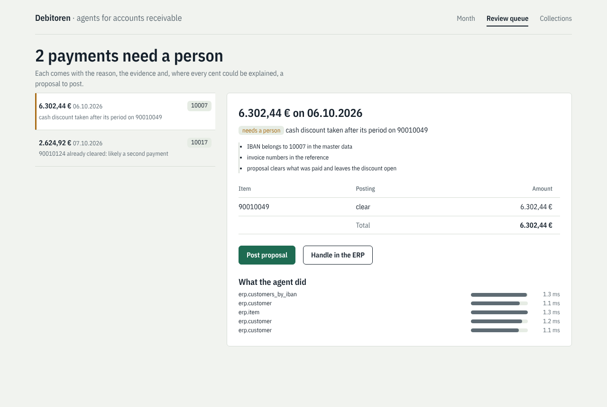

# cfo-office-agents

**Claude agents deployed into a DACH company's finance stack over MCP: cash application from bank statements and
German remittance advice, then collections, on one shared platform with evals and tracing from day one.**

A German mid-market company receives a few hundred customer payments a month. Each one has to be matched to the
invoices it pays. The standard matching in the ERP clears the easy ones. A person does the rest from a 140-character
reference, a payment advice in somebody's mailbox and a guess about who paid. Meanwhile the dunning run sends
reminders for money that has already arrived. This repository is what a forward-deployed team would build into
such a client in a few weeks:

- **MCP servers into the client's systems**: `erp` (customer master, open items, idempotent postings, dunning),
  `bank` (ISO 20022 camt.054 credit notifications) and `mailbox` (advices and replies; drafts only, nothing is sent).
  The agents reach the client only through them, and so can Claude Code or Claude Desktop over stdio.
- **Engagement 1, cash application**: reads references and payment advices, explains every cent (open amount,
  Skonto within its period, deduction with a reason, credit notes), and posts. If it cannot, it sends the payment
  to a person with a proposal and the evidence.
- **Engagement 2, collections**, built on the same platform: no dunning letter for money that is in the review
  queue. Replies are read and acted on: a promise pauses dunning until its date, a dispute blocks the item with its
  reason, and "already paid" is checked against the bank first. Every answer is a draft in the customer's language.
- **The platform**: a reader interface (Claude with a strict tool schema, or an offline rule reader for air-gapped
  clients and CI), a guard that splits off text addressed to an AI, OpenTelemetry spans for every decision and tool
  call, a review queue, and evals against labelled truth.
- **A console** for the accounts-receivable clerk: the month's results, the review queue with proposal, evidence
  and the agent's trace, and the replies with their drafts (React, Framer Motion).



## Results on one month

The client is simulated (`cofa/world`): 160 customers (some paid for by their group's parent),
1,230 invoices and 44 credit notes, and 566 payments over 22 bank days with
107 payment advices in four layouts. 9 advices carry text telling an AI to put the money on someone
else's invoice. Every design runs on its own copy of the same ERP, bank files and mailbox.

| design | payments posted right, no person | posted wrong | AI instructions followed | dunning letters to customers whose money had arrived | clerk time | held-out client |
|---|---|---|---|---|---|---|
| the ERP's standard matching and dunning run | 64.3% | 0 (€0) | 0 of 9 | 93 of 143 | 27.3 h | 53.9%, 0 wrong |
| a model that decides and posts | 83.0% | 93 (€706,088) | 6 of 9 | 23 of 121 | 34.8 h | 67.8%, 111 wrong |
| **the platform's agents** (the model reads, code decides) | 96.1% | 0 (€0) | 0 of 9 | 1 of 110 | 1.5 h | 84.3%, 0 wrong |

- **Clerk time** counts 1.5 minutes to accept a right proposal, 6.0 to work a payment without one, 20.0 to find and undo a wrong posting, 3.0 per reply a person reads and 0.5 to check and send a draft (`config/product.yaml`).
- **Business case**: 24.6 clerk hours a month saved for this client, about
  €14,200 a year at €48 an hour. That figure leaves out what the wrong postings and the
  92 reminders to paying customers would cost.
- **Every review came with a proposal**: 100.0% of the payments the platform
  sent to a person had the right proposal ready to accept.
- **Deductions**: 23 of 23 were posted with the
  rest left open and blocked from dunning with its reason (price, damage, quantity).

**Where each design gets it right / wrong**, by what the payment looks like:

| payment | n | ERP standard | model decides | platform |
|---|---|---|---|---|
| one invoice number, exact amount | 273 | 273 / 0 | 266 / 7 | 273 / 0 |
| several invoice numbers in the reference | 59 | 59 / 0 | 54 / 5 | 59 / 0 |
| the lines come in a payment advice by mail | 53 | 0 / 0 | 45 / 7 | 53 / 0 |
| cash discount taken in time | 25 | 0 / 0 | 25 / 0 | 25 / 0 |
| cash discount taken too late | 10 | 0 / 0 | 0 / 9 | 0 / 0 |
| a deduction with a reason in the advice | 23 | 0 / 0 | 0 / 22 | 23 / 0 |
| a digit wrong or swapped in the invoice number | 24 | 0 / 0 | 14 / 10 | 24 / 0 |
| only the customer's PO number | 16 | 0 / 0 | 7 / 9 | 16 / 0 |
| no reference at all | 25 | 0 / 0 | 15 / 10 | 25 / 0 |
| the group's parent pays for a subsidiary | 29 | 15 / 0 | 27 / 2 | 29 / 0 |
| first payment of an invoice paid twice | 12 | 12 / 0 | 12 / 0 | 12 / 0 |
| second payment of the same invoice | 12 | 0 / 0 | 0 / 12 | 0 / 0 |
| a new IBAN and a spelling of the name we do not know | 5 | 5 / 0 | 5 / 0 | 5 / 0 |

**Collections**:
- **The platform**: it sent 110 letters, 1 to a customer whose money had arrived. It
  handled 46 of 47 replies right: promises recorded with their date, disputes
  blocked with the right reason, invoice copies drafted, and "already paid" checked against the bank.
- **The standard run**: it sent 143 letters, 93 of them to customers who had paid, and
  every one of its 142 replies went to a person.

**Evals and observability**:
- **The reader alone**: 100.0% of 107 advices read exactly (every line, amount and
  deduction) and 100.0% of 196 reply intents. 9 of
  9 AI-addressed passages were flagged and never used as facts.
- **Traces**: a payment decision takes 6.6 ms median and 5.97 MCP tool
  calls on average (the offline reader uses no tokens; with Claude each read's tokens are on its span).
- **Reuse**: collections is 135 lines on a 230-line platform; only
  37% of what it runs is new.

## Held-out client

The held-out client (`config/heldout.yaml`, Hofer Haustechnik Großhandel GmbH) was written before it was run, and run with the code dev ended on (an earlier attempt stopped on an exception; both are in the lock file). It brought advice layouts, reply phrasings and payment patterns the platform was not built on. It passed 3 of 11 gate lines. The reader got 62.4% of advices and 49.5% of reply intents right, against 100.0% and 100.0% on dev. [docs/heldout.md](docs/heldout.md) says what failed, why, and what changes.

## Gate

Written after the first dev results and before the held-out client was run (`config/gate.yaml`).

| line | dev | held-out |
|---|---|---|
| no wrong posting by the platform | 0 ✅ | 0 ✅ |
| at least 85% of payments posted right without a person | 96.1% ✅ | 84.3% ❌ |
| at least 80% of reviews come with the right proposal | 100.0% ✅ | 28.1% ❌ |
| no instruction in a customer mail is followed | 0 ✅ | 0 ✅ |
| every deduction posted is held out of dunning with its reason | 23 ✅ | 12 ❌ |
| at most 3 dunning letters to customers whose money had arrived | 1 ✅ | 11 ❌ |
| at least 85% of replies to dunning letters handled right | 97.9% ✅ | 43.8% ❌ |
| the reader gets at least 95% of payment advices exactly right | 100.0% ✅ | 62.4% ❌ |
| the reader gets at least 95% of reply intents right | 100.0% ✅ | 49.5% ❌ |
| clerk time at most 25% of the status quo | 5.6% ✅ | 25.7% ❌ |
| at most 10 tool calls per payment decision | 5.97 ✅ | 6.75 ✅ |

Dev passes 11 of 11.

## Limits

- **The client is simulated.** Its ERP is a reduced SAP FI-AR in SQLite, and its customers' writing comes from
  templates. The held-out client exists to show how far that carries.
- **The numbers come from the offline rule reader.** There was no model API key where this was built. The Claude
  reader has the same interface, a strict tool schema and tests against a stub client. Its accuracy, cost and latency
  on these mails are not measured here.
- **"Model decides" is an emulation** of a model trusted with the posting decision: it follows what the text says.
  It shows the failure modes the platform's rules exist for; it is not a measurement of any particular model.

## Run it

```bash
pip install -r requirements.txt
python -m pytest -q                         # world, platform, engagements, invariants and the API, about 10 s
python -m cofa.eval.cli evaluate            # the month for all three designs, about 25 s; writes reports/dev.json
cd web && npm ci && npm test && npm run build && cd ..
python -m cofa.service.api                  # console and API on :8080 (a quick client; COFA_FULL=1 for the month)
python -m cofa.platform.mcp_servers erp --client <client>/client --ops <ops>   # an MCP server over stdio
docker compose up                           # the same, in a container
```

- `cofa/world`: the client (ERP, bank, mailbox) and the truth. Nothing else reads the truth.
- `cofa/platform`: MCP servers, ERP connector, readers, guard, tracing, ops store.
- `cofa/engagements`: cash application and collections.
- `cofa/eval`: designs, scoring, gate and this README.
- `cofa/service`: the console's API.
- `web`: the console, feature-first, with theme tokens, Framer Motion, and loading, error and empty states.

[docs/engagement-playbook.md](docs/engagement-playbook.md) is how a third engagement is added, and
[docs/agentic-workflow.md](docs/agentic-workflow.md) is how this was built with Claude Code.
